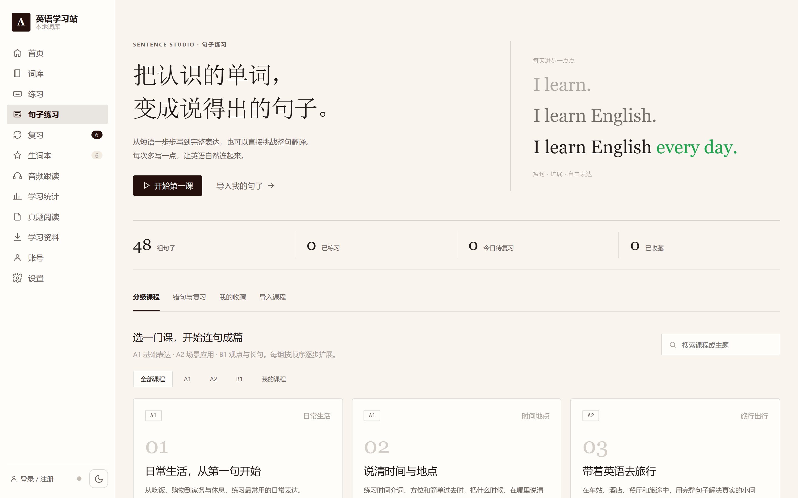
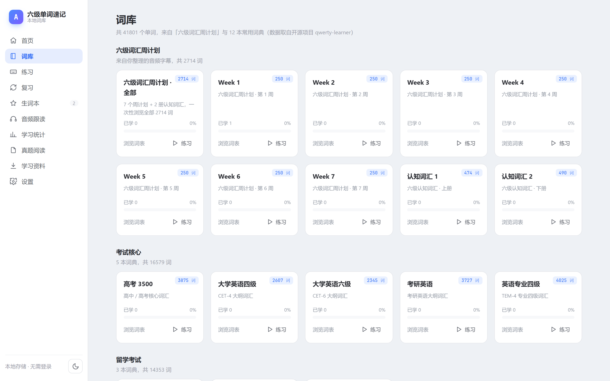
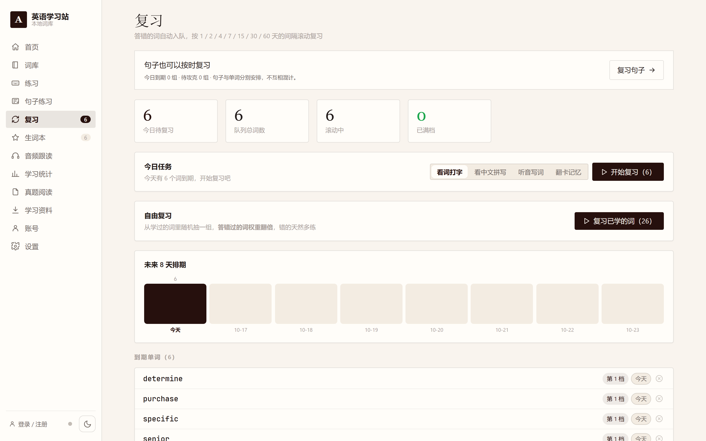
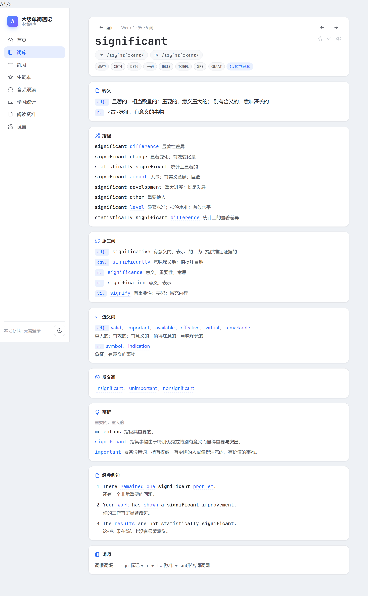

# 英语学习站（TypingEnglish）

一个**打字背单词**的静态网站，风格与交互参考开源项目
[TypeWords](https://github.com/zyronon/TypeWords)，词库来自自己整理的
「六级词汇周计划音频」字幕文件。

零依赖、零构建：**双击 `index.html` 就能用**，也可以直接托管到 GitHub Pages。

🌐 **在线地址**：<https://sunfleeting.website>（主域名，Cloudflare 托管国内可直连）
　 备用：<https://sunfleeting-debug.github.io/EnglishLearningWebsite/>（GitHub Pages）

📥 **现成的 App（不用装环境）**：到 [Releases](https://github.com/sunfleeting-debug/EnglishLearningWebsite/releases/latest) 下载——

- `EnglishLearningStation-1.0.0-portable.exe`：**Windows 桌面版**，单文件免安装，双击即用（Electron 壳，窗口内自带本地服务，音频拖动/离线学习全部可用）
- `EnglishLearningStation-1.0.0-debug.apk`：**Android 安装包**（Capacitor 打包的 debug 签名），传到手机直接安装

📱 **手机上也可以不装 App**：用手机浏览器打开上面的网址 → 分享菜单 → 「添加到主屏幕」，
之后就像 App 一样全屏打开（已配 PWA 图标、manifest 与离线缓存）。
移动端做了针对性优化：底部导航栏、单列布局、**词典数据按需加载**（首屏 JS 从 ~5.7MB 降到 ~0.8MB）。










## 功能

**本机资料：星火六级**

- 在电脑 Edge / Chrome 打开网站，在「题目」「写作」或「听力」选择一次 `星火六级` 文件夹；资料按名称与目录自动分类，可搜索、筛选、浏览 PDF 和播放音频。Word、表格及压缩包可下载后用本机应用打开。
- 资料通过浏览器只读访问，文件保留在原目录，不上传到网站或 GitHub；更换浏览器或设备需要重新选择。部分情况下浏览器会要求重新授权。
- 目录中已转换并核对的客观题会出现在题目板块，交卷后自动判分；「听力」也可进入配套录音的真题练习。目前包括 2020 年 12 月、2021 年 6 月和 12 月各三套阅读和两套听力、2022 年 6 月第 1、2 套阅读和共用听力、2022 年 9 月及 2023 年 3 月的共用阅读和听力，以及 2022 年 12 月、2023 年 6 月和 12 月、2024 年 6 月和 12 月、2025 年 6 月和 12 月各三套阅读、各两套听力，以及 2026 年 6 月三套阅读和两套听力，共 1,725 题。其他试卷和扫描件仍需逐题转换与核对。
- 部分真题作文和翻译题可在「写作」中练习并使用 AI 批改。文字来自原资料的 Word 或 PDF 文本层，可能存在识别错误，PDF 提取的题目建议对照原卷；未附范文的题目不会显示参考答案按钮。图表缺失的作文不纳入题库。
- 本机转换数据保存在所选目录根部的 `英语学习站-自动判分题库.json`，不会上传；选择或更新 `星火六级` 文件夹后加载。转换脚本 `tools/build_personal_papers.py` 需要 PyMuPDF 和 python-docx，依赖原试卷，客观题只纳入已核对的答案。
- 2026 年 6 月扫描卷的已核对部分由 	ools/build_scanned_personal.py 单独生成到本机资料夹，再运行主转换脚本合并；重建识别结果还需要安装 rapidocr-onnxruntime、NumPy 和 PyMuPDF。扫描识别可能有文字错误，建议对照原卷。


**句子练习（Sentence Studio）**
- 独立「句子练习」导航和首页入口，包含原创分级课程，以及 20 句注明作者和出处的经典文学句子。
- **递进练习**：从短语逐步扩展为完整表达；**整句翻译**：看中文输入完整英文；另有**听音写句**，练习中可切换，保留当前句子。
- 按 Enter 检查；整句翻译的标准答案和预设等价答案可直接通过，其他表达交由已配置的 AI 按句意判断；AI 不可用时提示重试，不会自动判错。递进练习与听写仍按目标句检查。
- 收藏、错句本、当日到期与 1 / 2 / 4 / 7 / 15 / 30 / 60 天间隔复习；答错或看答案后即加入复习，未完成退出也不丢失。
- 一组最终完成才计一次；提示、跳过、错后改对和无中文英文跟打均归为辅助练习，不冒充独立答对，也不会延长复习间隔。
- 刷新和切页可续学；完成后结算、继续下一组；收藏与已练句子的多批练习会覆盖全组后再循环。
- 粘贴中英句对 / 英文文章，或导入 JSON、CSV、TSV、TXT、SRT、VTT；**先预览再确认**，支持自定义递进课程与等价答案。无中文素材明确使用英文跟打，不自动生成翻译；音视频可先导出字幕后导入。
- 句子课程和进度**保存在当前浏览器**，纳入设置页的整站导出 / 导入备份；当前账号云同步仍只覆盖单词数据。
- 设计参考 [Earthworm](https://github.com/cuixueshe/earthworm) 的递进表达与键盘练习方式，代码和课程为本项目独立实现。详见 [句子练习说明](docs/sentence-practice.md)。

**AI 英语教练（聊天式）**
- 侧边栏「AI 助手」是一个 ChatGPT 式聊天页：**流式输出**、多轮上下文、消息里直接嵌**可作答的练习题**。
- **自带 Key**：DeepSeek / 通义千问 / ChatGPT / Claude / 自定义（任何 OpenAI 兼容接口，含本地 Ollama、LM Studio）。
  Key 只存本机 `typingcet.ai.v1`，**不进云同步、也不进导出备份**；请求经本站 Worker 转发
  （`POST /api/ai/chat`），Worker 只做格式转换，不落库、不记日志。
- **模型从接口选，不用手打**：填完 Key 自动拉 `POST /api/ai/models`（转发上游 `/models`）出下拉框，
  换 Key 会重新拉；接口没实现 `/models` 时留「手动填写」兜底。
- **自定义接口先走浏览器直连**：同一句请求先由你的浏览器直接发给上游（用你自己的出口 IP），
  CORS 被拦才退回 Worker 转发。中转/免费网关多半挂在 Cloudflare 后面并按 IP 限流
  （`error code: 1015`），Worker 的共享出口 IP 特别容易被限；这次连带把上游状态码、主机名和
  针对性提示一起显示出来，报错旁边还有「重试」。
- **会读你的真实数据**：每次请求把已学 / 掌握 / 错词 / 今日到期 / 近 7 天正确率 / 分书进度 / 最近场次
  打包进 system prompt，模型只做归因和建议 —— 数字由本地算好，它编不出来。
- **会出题**：约定模型在回复末尾附一个标记为 `quiz` 的代码块，前端把它从正文里摘掉、渲染成
  选择 / 拼写 / 填空卡片；交卷**本地判分**，结果写回学习记录（对错计数 + 复习队列 +
  统计页里记为「AI 出题」场次）。
- **会复盘**：交卷后可让教练逐题讲错因，错题作为一条消息进入对话上下文，顺着聊就行。
- **会存历史**：每条对话自动存本机（`typingcet.ai.chat.v1`），右栏「历史对话」和顶栏「历史」都能翻回去接着聊，
  可单条删除；「新对话」开始前会把当前这条先落盘。
- **会发布**：AI 生成的题目卡可发布到题目板块；生成写作题和听力题后，可分别发布到写作和听力板块。生成内容在当前浏览器保存，听力使用浏览器语音，不冒充真题。
- **会联网**：打开联网开关后，涉及搜索、资料、官网和时效性信息的问题会调用 Worker 的 `/api/ai/search`。服务端并行尝试必应资讯、必应网页和 DuckDuckGo，合并去重并保留结果链接；可用来源取决于各搜索服务的实际响应，不能保证每次有多个来源。搜索无结果时会明确提示，不将未经核实的信息当作实时结果。
- **学习上下文**：读取本机的单词、写作、题目、听力成绩与部分错题；已完成的单词场次包含有限的词条明细，场次时间不等同于每个词的操作时间。账号、密码和 API Key 不纳入学习上下文。写作、听力、句子、生成题及对话等资料当前不参与账号云同步，保存在当前浏览器的本地存储中，不能保证按账号隔离。
- **单词详解里的 AI 对话**：围绕当前单词多轮追问；离开详解页即清除，不写入 AI 助手历史。模型服务仍会收到当前词与提问内容。
- **题目、写作、翻译与听力的 AI 对话**：详情页内可结合当前题目和作答连续追问；切换题目或离开页面后清除，不写入助手历史。内容会发送给所配置的模型服务。
- **搜词 AI 兜底**：词库和在线词典都未找到时，使用已配置的 AI 自动解释；若 AI 未配置或模型请求失败，会显示配置或重试提示。
- 没填 Key 时只显示接入卡，站内其它功能完全不受影响。

**题目板块（六级阅读真题 + AI 出题）**
- 侧边栏「题目」：把 `DRJ172简六级阅读` 扫描件里的**整套阅读练习**搬进了网页，2 套 Model Test × 4 篇 = **8 组 60 题**。
- 三种题型都按真题的方式做：
  - **选词填空** —— 正文里是 10 个空位，从 15 词（A~O）词库里挑，一个词只能用一次，答案比字母（与书一致）；
  - **段落匹配** —— 10 条题干配 A~O 段落字母，正文按段落排好、可对照着找；
  - **仔细阅读** —— 四选一，交卷后逐题给对错。
- **解析是完整的**：每题都带书上的【定位】+【解析】原文（为什么选它、其它选项错在哪），仔细阅读另附**整篇参考译文**。
- 做完当场判分并记住成绩（列表上显示「上次 x%」），可以「再做一遍」；做题记录存本机，不联网也能用。
- **AI 出的题也能进这里**：AI 教练生成后点「发布到题目板块」，这组题就固定下来，之后随时重做（选择题/拼写题都能判）。
- 数据由 `tools/build_quiz_bank.py` 从 OCR 结果生成（`data/quiz.js`），段落字母被扫描吞掉的个别处按原文补齐并写在脚本的 `PARA_PATCH` 里。

**词库（选择词典）**
- **六级词汇周计划**：Week 1–7（各 250 词）+ 认知词汇 1/2（474 / 490 词），共 2714 词
- **常用词典 12 本**：高考 3500 / 大学英语四级 / 大学英语六级 / 考研英语 / 英语专业四级 /
  雅思 IELTS / 托福 TOEFL / GRE / 商务英语 BEC / 牛津核心词 / 朗文交际 3000 / 新概念英语 2
  —— 共 **39087 个词条**，整站合计 **41801 词**
- 「词库」页就是**词典选择页**：按类别（六级周计划 / 考试核心 / 留学考试 / 职业英语 / 通用权威）
  分组展示词典卡，每张卡带词数、已学数、掌握进度，可「浏览词表」或直接「练习」
- 词典数据**按需加载**：只有打开某本词典时才注入 `data/dicts/<id>.js`（100~450KB/本），
  目录本身只有 1.7KB，首屏不受影响
- **首页搜词是全量的**：一次搜索覆盖所有 14 本词典（进首页空闲时按常用度后台预取，
  结果最多 100 条、区域可滚动）；词库没有的词走有道在线兜底，可点开详解
- **搜索历史**：聚焦空输入框显示最近 10 条，可点击重搜、一键清空
- 每个词条带美/英音标与中文释义；搜索（单词 / 释义）、按学习状态筛选（未学 / 错词 / 收藏 / 已掌握）、分页浏览

**复习（艾宾浩斯遗忘曲线）**
- 练习中**答错的词自动进入复习队列**（可在设置里关闭）
- 答对一次升一档，8 档间隔：**今天 / 1 / 2 / 3 / 4 / 6 / 7 / 10 天**（第一档是「当天再巩固一次」，10 天满档）
- 答错归零档并**当天再练一次**；同一天第二次还错就**顺延到明天** ——
  否则一个总拼错的词会被每一轮复习反复抓进来、把整组占满，其它到期词反而排不上
- 独立「复习」页：今日待复习数、队列规模、滚动中 / 已满档、**未来 8 天排期条**、到期单词清单
  （含档位与逾期天数，可单个移出）
- 侧边导航「复习」带**待复习角标**，首页也有一张「今日复习」提醒卡
- 可直接用「开始复习」进入练习（四种模式随便挑），会话结束显示队列还剩多少词

**生词本（跨词库）**
- 待攻克错词 / **最近学过** / 收藏 / 已掌握 / 我的笔记 / 已练过，**统计口径覆盖所有词库**（周计划 + 各本词典）
- 「最近学过」可按 **1 小时 / 1 天 / 3 天 / 1 周 / 1 月** 筛，按最后一次练的时间倒序（离现在最近的排最前），
  「练习这组」会带着当前时间范围开练
- 词典词靠进度里的「词面快照」显示，**不需要先把词典加载进来**
- 错词行上直接显示该词在复习队列里的档位与到期时间，「练习这组」可按分组开一轮练习
- 列表分页除了上一页 / 下一页，还能**直接跳末页**、**输入页码跳转**（词库页同一套控件）

**词典详解（一词一卡）**
- 点词表右侧 💡 或任意链接，进入单词详情页：**搭配 / 派生词 / 辨析 / 近义词 / 反义词 / 经典例句 / 词源**
- **近义词、反义词、例句中的每个单词都可点击**：在本词书里的直接跳词条；不在本词书里的近义/反义词，
  也补了「扩展词条」（音标+释义）可以点开；自动做词形还原（`measures → measure`、`drastically → drastic`、`regulations → regulation`）
- 数据来自有道词典 jsonapi（搭配、派生、辨析、近义、例句、词源）+ Datamuse（反义词），全部离线打包
- **加载等待页是「名句积累」卡**：等词典数据时轮流展示英文名著名句（盖茨比/双城记/老人与海…附出处）与常用习语（附中文释义），白等变积累
- 词典数据**按首字母分块加载**：详情页只拉当前词所在的字母块（~200KB），不再是整本 5MB
- 详解页拼写练习卡带「**重练**」按钮（`Alt+R`）：拼对了想再打一遍，一键清空重来
- 每个词条都能写**学习笔记**（自动云同步），生词本里聚合为「我的笔记」分类

**练习（四种模式）**
| 模式 | 说明 |
| --- | --- |
| 看词打字 | 看着单词把它打出来，练拼写肌肉记忆 |
| 看中文拼写 | 只看中文释义，凭记忆写出英文单词 |
| 听音写词 | 听发音写出单词，练听力与拼写 |
| 翻卡记忆 | 先回忆再翻面，认识 / 不认识快速过词 |

**练习：键盘操作（尽量不用鼠标）**

| 按键 | 作用 |
| --- | --- |
| `Enter` | 打字类：提交答案；反馈页：继续下一词。翻卡：未翻面时翻面、已翻面时＝**认识** |
| `空格` | 翻卡翻面 |
| `Backspace` / `←` | 翻卡：**不认识** |
| `→` | 翻卡：认识 |
| `Esc` | 跳过本词（记为答错） |
| `S` | 发音 / 重听（听音写词的「重听」也是这个键） |
| `F` | 收藏 / 取消收藏 |
| `D` | 打开该词的**词典详解** |
| `H` | 听音写词：看中文提示 |
| `1` `2` `3` `4` | 切换练习模式（同上，**打字时让路**，不会把数字吃掉） |
| 完成页 `Enter` | 触发主按钮：还有没学的词就「学习下一组」，否则「再来一轮」 |

> 焦点在输入框里时，裸字母必须还是字母，所以**工具键要加 `Alt`**：
> `Alt+S` 发音 · `Alt+F` 收藏 · `Alt+D` 详解 · `Alt+H` 提示。
> 每轮练习的按钮上都印了对应的 `<kbd>` 快捷键，不用记。
>
> **进入每个新单词都会自动朗读它**（四个模式都有，可在设置里关；听音写词模式始终朗读）。
> 注意：「看中文拼写」模式朗读会连答案一起念出来 —— 想保留「只看中文回忆」的难度，
> 就到设置里把「进入新词时自动发音」关掉。

**练习：学完一组接着学下一组**
- 进入练习时**从第一个还没学的词开始**（顺序模式：从该词往后切；随机模式：在未学词里随机抽），
  所以学完 20 个再进来，接着练第 21~40 个，而不是又从第 1 个重来
- 一轮做完的完成页会显示**还剩多少个词没学**，并给出「**学习下一组**」；「再来一轮」则是**同一批词**重练一遍
- 整本都学完后不再显示「学习下一组」，改为提示「已经全部学完啦」

**练习：复习错词从「最近答错的那个」开始**
- 错词组按**最近答错的先后**排：改完立刻点「复习错词」，第一个就是刚才错的那个，
  而不是词表顺序里最靠前的错词（以前很可能排在第 N 个，等于先复习很久以前错的）
- 排序用的「最近答错」记录是**纯本地**的，不上传云端 —— 换设备只是退回词表顺序，不影响功能
- 生词本「待攻克错词」的列表页仍按「错得最多的在前」排（浏览视角），练习时则按上面的新近顺序

**音频跟读**
- 播放课程 mp3，按 `.lrc` 时间轴**自动高亮当前单词**
- 点击任意单词跳转到对应音频位置，支持「逐词暂停」听写模式

**生词本与统计**
- 答错的词自动进入错词本，并同时进入复习队列；收藏、已掌握集中管理
- 首页与统计页展示掌握进度、近 14 天练习量、连续学习天数、错得最多的词（跨所有词库）
- 统计页「近期场次正确率」**每一场都能点开**：这一轮错的词排在前面、对的在后，点单词直接进详解，
  旁边还有「去生词本」；最多保留 60 场（每场记 60 题明细），升级前的旧场次只显示总正确率

**其它**
- 浅色 / 深色主题，键盘音效与提示音
- 学习数据存于浏览器 localStorage，支持导出 / 导入 JSON 备份（含复习队列）
- 发音走「在线真人音频优先 + 系统语音兜底」双通道，可在设置页切换（见下方「关于发音」）

**账号与云同步（可选，默认关闭）**
- **进入前的登录门**：首次打开会先看到登录/注册卡；点「**游客模式 · 仅保存在本机**」可跳过，
  数据只存这台设备（之后随时可在「账号」页登录，本机进度自动并入云端）
- **邮箱验证码注册**：后端开启邮箱验证后，注册需填 6 位邮箱验证码（**Resend API 优先，
  失败自动降级 QQ SMTP 直连**；10 分钟有效、60 秒限重发、5 次错误作废）；验证码只存哈希
- 换设备登录后**自动合并**两边进度：每个词的错/对/已学/收藏/已掌握、每日练习量、复习队列档位
- **只传增量**：本地有脏标记，默认 3.5 秒防抖后只上传变动部分；登录、切页、关页面（beacon）会强制补一次全量
- 导航栏底部显示同步状态点（灰=离线 / 蓝=同步中 / 红=失败）
- 管理员进了 `ADMIN_EMAILS` 名单后能看到**管理看板**：用户列表、逐人下钻（错词/已掌握/收藏/复习队列）、
  近 14 天练习曲线、CSV 导出、重置他人密码

**移动端与桌面端**
- 自适应布局：窄屏改为底部导航栏 + 单列卡片，已断言「无横向溢出」（390×844 实测）
- PWA：`manifest.json` + 图标（192 / 512 / maskable / apple-touch），可「添加到主屏幕」全屏打开
- **Service Worker 离线缓存**：应用壳（HTML/CSS/JS/核心词库/句子课程/图标）首次访问即缓存，
  断网冷启动可用；发版后出现「有新版本，刷新」提示，点击即切到新资源。MP3/PDF/大词典
  不在首次安装时全量下载，按需缓存；音频 Range 请求交给服务器处理
- 词典卡与扩展词条按需加载，首屏 JS 约 0.8MB（详情页才按字母块加载当前词条）
- **Windows 桌面版**：`desktop/` 里的 Electron 壳，进程内自带支持 Range 的静态服务，
  打包为单文件 portable exe（见下方「打包桌面版与 Android App」）
- **Android App**：`android/` 是 Capacitor 原生工程，`npm run mobile:sync` 同步网页后
  `gradlew assembleDebug` 出 APK；手机底栏保留首页、词库、练习、句子练习、复习五个高频入口，
  其余功能在「更多」抽屉。完整说明见 [`docs/mobile-deployment.md`](docs/mobile-deployment.md)

## 快速开始

**方式零：下载现成的 App** —— 到 [Releases](https://github.com/sunfleeting-debug/EnglishLearningWebsite/releases/latest)
拿 Windows portable exe（双击即用）或 Android debug APK（传到手机安装）。

方式一：直接双击 `index.html`（无需任何环境）。

方式二：用仓库自带的本地服务器（**推荐**，音频才能拖动进度 / 点击字幕跳转）：

```bash
python tools/serve.py          # 默认 http://127.0.0.1:5173
python tools/serve.py -p 8080  # 换端口
```

> ⚠️ 别用 `python -m http.server`：它不支持 Range 请求，浏览器无法对 mp3 做时间跳转，
> 「音频跟读」页点击单词会跳转失败。`tools/serve.py` 补上了 Range（HTTP 206）支持。

也可以用 Node：`npx --yes serve . -l 5173`。

## 部署到 GitHub Pages（已启用）

线上地址：<https://sunfleeting.website>

这个站**零构建**，所以部署就是「推 main」——Pages 已配成 `main` 分支 `/ (root)`，
`git push` 之后一两分钟自动重新发布，无需任何构建步骤。

```bash
git push origin main    # 推完等 1~2 分钟即可
```

- 根目录放了 `.nojekyll`，让 Pages 跳过 Jekyll 处理，所有文件按原样提供
- 页面内全部使用相对路径 ⇒ 放在任意子路径（如 `/EnglishLearningWebsite/`）都能正常工作
- 首次开启 Pages（换仓库时）：Settings → Pages → Source 选 `Deploy from a branch`，
  Branch 选 `main`、目录 `/ (root)`；或用 API：
  `gh api --method POST repos/<owner>/<repo>/pages -f "source[branch]=main" -f "source[path]=/"`

## 打包桌面版与 Android App

两个产物都在 [Releases](https://github.com/sunfleeting-debug/EnglishLearningWebsite/releases) 里可直接下载；版本更新走 **GitHub Actions 自动发布**：推一个 `v*` 标签（如 `git tag v1.1.0 && git push origin v1.1.0`），流水线自动构建 exe + apk 并附到 Release（见 [`.github/workflows/release.yml`](.github/workflows/release.yml)，也可在 Actions 页面手动触发做纯构建验证）。本机手动打包时：

**Windows 桌面版（Electron，产出单文件 portable exe）**

```bash
cd desktop
npm install                                     # Electron 33 + electron-builder（走 npmmirror 快）
npm run dist                                    # 先拷站点资源到 app/，再打 exe
# 产物：desktop/dist/EnglishLearningStation-1.0.0-portable.exe
```

桌面壳原理：`desktop/main.js` 在进程内起一个**支持 Range 的静态服务器**（音频拖动必需），
再用 BrowserWindow 加载 `127.0.0.1` 地址；站点资源随 asar 进包，完全离线可用。
开发调试用 `npm start`（直接加载仓库根目录文件）。

**Android debug APK（Capacitor，需 Android SDK + JDK 17）**

```bash
npm install                                     # Capacitor 6 依赖
npm run mobile:sync                             # 网页资源复制进 www/ 并同步原生工程
cd android
JAVA_HOME="<JDK17 路径>" ./gradlew assembleDebug
# 产物：android/app/build/outputs/apk/debug/app-debug.apk
```

> Gradle 发行包在 `android/gradle/wrapper/gradle-wrapper.properties` 里指向了腾讯云镜像
> （官方 `services.gradle.org` 在本机直连超时）；APK 是 debug 签名，供个人安装使用，
> 正式发布需要自行配置签名密钥。iOS 工程已生成，但签名构建只能在 macOS + Xcode 做。

## 后端与云同步（可选）

站点本身不需要后端。**只有想让进度跨设备保存时**，才需要额外部署一个 Cloudflare Worker。

选它的原因：免费额度足够（D1 5GB / 每天 10 万次请求）、不用管服务器、和 GitHub Pages 的静态站天然分开。

```bash
cd worker
npm i -g wrangler            # 或 npx wrangler
wrangler login

wrangler d1 create cet-words-db          # 建库，把输出的 database_id 填进 wrangler.toml
wrangler d1 execute cet-words-db --file=schema.sql --remote   # 建表

# 管理员邮箱（逗号分隔；在名单里的人登录后才看得到「管理看板」）
# 以及允许访问的前端来源（逗号分隔，防止别人拿你的接口地址乱调）
# 都写在 wrangler.toml 的 [vars] 里

wrangler deploy              # 拿到 https://cet-words-api.<你的账号>.workers.dev
```

> 本仓库的后端**已经部署好了**：<https://api.sunfleeting.website>（自定义域，国内可直连；
> `*.workers.dev` 旧地址仍在但国内被墙）。地址写在 `assets/js/config.js` 的 `apiBase` 里，
> 所以打开站点就能直接注册/登录。
> 但**不登录 = 纯离线模式**：不发任何请求，数据只在本机，全部功能照常。

部署好之后（换账号/换库时才需要重来一遍）：

1. 打开站点的「**账号**」页 → 「后端地址」里填 `https://...workers.dev` → 保存并测试
   （地址存在 localStorage 的 `typingcet.apiBase`，优先级高于 `config.js` 里的默认值）
2. 用邮箱 + 密码注册 / 登录；登录后本地进度会**整包上传并与云端合并**，之后只传增量
3. 在「管理看板」里能看到所有用户（仅 `ADMIN_EMAILS` 名单内的邮箱能看到这个入口）

### 线上后端冒烟测试

改完后端代码后，除了跑本地 mock，还可以直接打线上接口确认真的部署好了：

```bash
python tools/smoke_api.py        # 46 项断言：根地址落地页 / 健康检查 / 注册登录 / 同步合并 / 删除清空 / CORS / 权限 / 错误路径
```

> 后端根地址 <https://api.sunfleeting.website> 是一个**说明页**（列出所有 `/api/*` 接口
> 并链回前端站点），不是报错 —— 访问它看到 HTML 属于正常。

> ⚠️ 几个环境坑（脚本里都处理了，但排查时要知道）：
> ① 本机到 `*.workers.dev` **必须走代理**（直连超时），而 `api.cloudflare.com` 相反要直连；
> ② Cloudflare 会对 `Python-urllib` 这类 UA 直接回 `403 error code: 1010`，脚本因此伪装了浏览器 UA；
> ③ 链路会间歇性断（同一请求 200/000 交替），脚本对传输错误做了重试 —— 别把 `status=0` 当成后端故障；
> ④ **「系统代理」不一定能用**：环境里的 `HTTPS_PROXY`（`127.0.0.1:58575`）会对 `workers.dev` 回
>    `Tunnel connection failed: 502`，症状是**所有**请求 status=0、看着像后端挂了。
>    换一个本地代理端口即可：`SMOKE_PROXY=http://127.0.0.1:7897 python tools/smoke_api.py`。

### 同步的合并规则

服务端以「谁更多 / 谁更新」为准，不做简单覆盖：

| 字段 | 规则 |
| --- | --- |
| `w`（错）/`r`（对）/`seen`（已学） | 取 **max** |
| `fav`（收藏）/`master`（已掌握） | 取 **时间戳更新**的那条 |
| `daily.done` / `daily.right` | 取 **max** |
| 复习队列 `srs` | 整条按 **ts** 取新（间隔与到期日必须自洽，不能逐字段合并） |

删除走显式名单（`deleted`），清空走 `clear`，所以「本机删掉某个词」不会被下一次全量上传复活。

### 隐私与安全

- **只存邮箱（小写）和 PBKDF2-SHA256 加盐哈希**（10 万轮），不存明文密码；登录令牌是 32 字节随机数、30 天过期
- 同步的内容只有：单词 id、词面快照、对错计数、收藏/掌握标记、复习档位、每日练习量 —— 没有其它个人信息
- **注册与找回密码都走邮箱验证码**（Resend API 优先，失败降级 QQ SMTP 直连）；验证码只存哈希、10 分钟过期
- **AI 助手的 API Key 完全不经过后端存储**：只在你自己的浏览器里，请求转发时随请求体一次性带给模型官方接口
- 不登录不会产生任何云端数据；登录后数据归该账户，管理员只能查看统计与重置密码
- `ALLOWED_ORIGINS` 建议填上你的 Pages 地址，避免接口被别的站点盗用

## 目录结构

```
.
├── index.html              # 入口（单页应用）
├── manifest.json           # PWA 清单（添加到主屏幕）
├── service-worker.js       # PWA 离线缓存（应用壳 cache-first，发版必须 bump CACHE_VERSION）
├── offline.html            # 断网兜底页
├── data/quotes.js          # 详解页加载等待卡的「名句积累」语料
├── .nojekyll               # 让 GitHub Pages 跳过 Jekyll
├── android/                # Capacitor Android 原生工程（出 APK）
├── ios/                    # Capacitor iOS 原生工程（需 macOS + Xcode 构建）
├── desktop/                # Electron 桌面壳（出 Windows portable exe）
│   ├── main.js             # 进程内静态服务器（带 Range）+ BrowserWindow
│   ├── build.mjs           # 打包前把站点白名单资源拷到 desktop/app/
│   └── package.json        # electron-builder 配置（产物在 desktop/dist/）
├── assets/
│   ├── css/style.css       # 全部样式
│   ├── img/                # PWA 图标（192 / 512 / maskable / apple-touch）
│   └── js/
│       ├── util.js         # 工具函数、SVG 图标、Toast
│       ├── store.js        # 学习状态（localStorage 持久化 + 脏标记）
config.js       # 后端地址（留空即纯离线）
api.js          # 后端接口客户端（Bearer token）
sync.js         # 增量同步调度（防抖 / 强制全量 / 页面隐藏 beacon）
│       ├── speech.js       # 发音双通道（在线音频 / 系统语音）+ WebAudio 音效
│       ├── data.js         # 词库访问层
│       ├── components.js   # 共享 UI 片段（含单词链接 / 例句分词）
│       ├── ai.js           # AI 教练内核（模型配置 / 流式请求 / 学习数据快照）
│       ├── app.js          # 侧边导航 + hash 路由
│       └── views/          # 各页面（首页/词库/详情/练习/复习/生词本/AI 助手/音频/统计/阅读/资料/设置/账号/管理）
├── data/
│   ├── words.json/js       # 2714 个词条（含音标、释义、音频时间轴）
│   ├── dict.json/js        # 词典卡（搭配/派生/辨析/近义/反义/例句/词源）
│   ├── dict/<L>.js         # 词典卡按首字母分块（25 块，详情页按需加载）
│   ├── dict-ext.json/js    # 扩展词条（近义/反义词中非本词书者，音标+释义）
│   ├── dict-ext/<L>.js     # 扩展词条按首字母分块
│   ├── sentences.js        # 句子练习课程（6 门 / 48 组 / 144 步）
│   ├── quotes.js           # 加载等待页名句与习语
│   ├── books.json/js       # 词书元信息
│   └── dicts/              # 12 本常用词典（index.js 目录 + 每本一个按需加载的 js）
├── THIRD-PARTY.md          # 第三方数据来源与许可
├── audio/                  # 压缩后的课程音频 + 原始字幕
├── resources/              # 六级阅读 PDF
├── worker/                 # 后端（Cloudflare Workers + D1）
│   ├── index.js            # 注册/登录/同步/管理接口
│   ├── schema.sql          # D1 建表
│   └── wrangler.toml       # 部署配置（ADMIN_EMAILS / ALLOWED_ORIGINS）
└── tools/                  # 数据构建与核验脚本（见下）
```

## 数据是怎么来的

```
六级词汇周计划音频/*.lrc   ──┐
                            ├──► tools/build_data.py ──► data/words.json
有道词典 jsonapi（音标+释义）─┘                             │
                                                          ▼
                                        tools/make_js_data.py ──► data/words.js

有道 jsonapi（搭配/派生/辨析/近义/例句/词源）─┐
Datamuse api（反义词）──────────────────────┴──► tools/enrich_dict.py ──► data/dict.json/js
```

```bash
# 1) 解析字幕 + 抓取音标/释义（结果缓存在 tools/.cache，可重复运行）
python tools/build_data.py

# 2) 把 JSON 包装成可直接 <script> 引入的 JS
python tools/make_js_data.py

# 3) 构建词典卡（一词一卡：搭配/派生/辨析/近义/反义/例句/词源）
python tools/enrich_dict.py

# 4) 为词典卡里那些不在本地词书的近义/反义词补轻量词条（让链接真正跳得动）
python tools/build_dict_ext.py

# 5) 抓取并转换 12 本常用词典（qwerty-learner，GPL-3.0）→ data/dicts/
python tools/build_qwerty_dicts.py            # 带 tools/.cache/qwerty 磁盘缓存，可重跑
python tools/build_qwerty_dicts.py --refresh  # 忽略缓存重新抓取
```

- `build_data.py` 会自动处理三类特殊写法：同形异义标记 `bass①`、拼写变体
  `specialize,-ise`、编号 `utter1`
- 抓取结果按单词缓存到 `tools/.cache/youdao/`（词典卡为 `tools/.cache/raw/` 与
  `tools/.cache/datamuse/`，词典为 `tools/.cache/qwerty/`），重跑不会重复请求
- 有道没有「反义词」字段，`enrich_dict.py` 用 Datamuse 的 `rel_ant` 补充；
  有道没有「搭配」的词，则从例句中挖掘与该词高频共现的短语（标注为「语料搭配」）
- `build_qwerty_dicts.py` 抓的是 qwerty-learner 的 `public/dicts/*.json`（`{name, usphone, ukphone, trans}`），
  转成本站紧凑格式 `[单词, 美音, 英音, "释义\n释义"]` 并按小写词形去重；第三方来源与许可见 `THIRD-PARTY.md`

### 各板块数据覆盖率（全量 2702 词）

| 板块 | 来源 | 覆盖 |
| --- | --- | --- |
| 释义 / 音标 | 有道 jsonapi | 100% |
| 经典例句 | 有道 jsonapi | 99% |
| 考频标签 | 有道 jsonapi | 99% |
| 近义词 | 有道 syno | 94% |
| 词源 | 有道 etym | 91% |
| 派生词 | 有道 rel_word | 81% |
| 搭配 | 有道 phrs（不足则语料挖掘） | 67% + 30% |
| 辨析 | 有道 discriminate | 43% |
| 反义词 | Datamuse rel_ant | 25% |
| 扩展词条 | 有道 jsonapi | 5653 条（近义/反义词里非本词书者） |

> 没有数据的板块会自动隐藏，不会出现空标题。

## 本地核验

```bash
bash tools/verify.sh          # 起服务 + 跑 Playwright，共 181 项断言 + 截图
```

核验通过的标准：`失败 0 / 共 181 项断言`，且控制台错误数 = 0。截图落在 `docs/shots/`。
断言覆盖：数据层（词条数 / 词典目录 / id 唯一 / 字节级原样下发）· 各页面渲染 ·
练习四模式与「答错先给重做机会」· 翻卡跨会话覆盖回归 · 词典按需加载与字母分块 ·
全量搜索与搜索历史 · 名句积累加载卡 · 详解页重练按钮 · 生词本跨词库统计 ·
复习队列（自动入队 → 到期 → 答对升档推到明天 → 待复习清零）·
移动端无横向溢出 · 控制台 0 错误。

> 脚本会先自检端口是否被占用（Windows 下 `SO_REUSEADDR` 允许多进程绑同一端口，
> 一旦叠加，请求会随机落到旧进程，造成「时好时坏」的假失败）。
> 若提示端口被占，按输出里的 `taskkill /PID <pid> /F` 结束残留进程再跑。

发音双通道单独核验（13 项断言：音频请求 / 缓存 / 失败回退 / 模式切换）：

```bash
python tools/verify_speech.py
```

练习页键盘操作与「学下一组」核验（92 项断言）：

```bash
python tools/verify_practice.py
```

覆盖：翻卡 空格/Enter 翻面 → Enter 认识 / Backspace 不认识 / Esc 跳过 · 空格翻面 ·
打字模式反馈页 Enter 继续（旧实现这里按 Enter 没反应）· 1~4 换模式（且打字时不抢键）·
完成页「学习下一组」与剩余词数 · 「再来一轮」重练同一批词 ·
**重进练习页从第一个没学的词开始** · 全部学完后不再提示下一组 ·
**四个模式进入新词都自动朗读**（且翻面重画不重复朗读）·
工具键 `S`/`F`/`D`（打字时 `Alt+` 组合，裸字母仍能正常输入）· 控制台 0 错误。

后端与同步端到端核验（56 项断言，用 **Python 标准库写的假后端**跑真实浏览器流程，
不需要真的 Cloudflare 账号）：

```bash
python tools/verify_backend.py
```

AI 教练页核验（29 项断言，模型接口全部 mock 成 SSE，不触网、不烧额度）：

```bash
python tools/probe_ai.py
```

覆盖：未配置只出接入卡 · 保存并开始进入聊天壳 · 流式回复里的 `quiz` 代码块被摘出正文并渲染成
练习卡 · 作答后本地判分 100% 并**写回学习记录与场次** · 复盘走对话 · 新对话清空 ·
手输 + Enter 发送 · markdown 渲染 · 设置页配置卡 · 深色主题 · 控制台 0 错误。

线上后端冒烟（打真实接口，见上方「后端与云同步」）：

```bash
python tools/smoke_api.py
```

覆盖：不登录也能用 · 注册并被识别为管理员 · 答题后自动同步 · 合并取 max 不回退 ·
换设备登录恢复进度 · 管理看板下钻（且不被后台同步重渲染关掉）· 非管理员 403 ·
管理员重置密码 · 退出登录后本机数据仍在 · 控制台 0 错误。

> `tools/mock_api.py` 是 Worker 接口与合并规则的**逐条等价实现**（纯 stdlib），
> 改 `worker/index.js` 时两边要同步改，否则本地绿、线上错。

线上验收（真开一次已部署的站点）：

```bash
NODE_OPTIONS= python -u tools/verify_live.py
```

26 项断言：标题 / 首页渲染 / 词库列表 / 详情页与按需加载 / 近义词跳转 / 发音通道 /
真题阅读页与答题卡 / 答错给重做机会 / 词典目录与按需加载 / 复习队列自动入队与角标 /
移动端无横向溢出 / 控制台错误 0 / 资源失败 0。

句子练习独立核验（197 项断言，合并自句子练习分支自带测试）：

```bash
python tools/verify_sentences.py
```
> 启动 Chromium 需要真实环境（用沙箱 Bash 跑 Playwright 时需关闭沙箱，否则浏览器进程会被拦截）；
> 另外 Playwright 版本必须与已下载的 `chromium_headless_shell` 版本一致，
> 不匹配时先执行 `python -m playwright install chromium-headless-shell`。

## 说明

- 中文释义来自在线词典，抓取后离线打包，仅供个人学习使用
- 12 本常用词典的词表取自开源项目 [qwerty-learner](https://github.com/RealKai42/qwerty-learner)（GPL-3.0）；
  **第三方数据来源与许可逐项列在 [`THIRD-PARTY.md`](THIRD-PARTY.md)**
- 复习调度为自研实现：固定间隔 1/2/4/7/15/30/60 天，答对升档、答错归零（不是 FSRS）
- 不登录时学习记录只存在本机浏览器，换设备或清理浏览器数据会丢失（可先导出备份，或登录做云同步）
- 云同步是**可选**的：不配后端地址就完全不联网上传任何学习数据

### 关于发音（没声音怎么排查）
发音有两条通道，可在「设置 → 发音与音效 → 发音方式」切换：

| 方式 | 行为 |
| --- | --- |
| 自动（默认） | 优先播在线真人音频；加载失败或 2.5 秒起不来则自动退回系统语音 |
| 在线音频 | 只用真人音频（有道 `dictvoice` mp3），音质最好，需要联网 |
| 系统语音 | 只用浏览器语音合成（Web Speech API），可离线 |

**为什么默认走音频**：系统语音合成在移动端有两个 JS 根本检测不到的静默失败 ——
iOS 物理静音键打开时事件照常触发却不出声；Android 未装英文语音包时直接哑掉。
而 `<audio>` 播放不受 iOS 静音键影响，所以更稳。

两路都听不到时，按顺序检查：

1. 手机侧边**静音键**是否打开（iOS 上会静音系统语音，切到「在线音频」可绕过）
2. 是否联网（在线音频需要）
3. 系统是否安装了英文语音引擎（Android 部分国产 ROM 未预装）
4. 页面音量与系统媒体音量

> 排查本机浏览器到底有没有可用的英文语音包：
> `python tools/diag_speech.py`（打印 voice 列表 + 实际 speak 事件 + 音频直链可用性）

## 致谢

交互与视觉风格参考 [zyronon/TypeWords](https://github.com/zyronon/TypeWords)（GPL-3.0）。
本项目为独立实现的静态版本，未复用其源码。

### 新增素材与验证

- `data/classics.js`：20 句带来源的经典文学英语短句与中文练习译文。
- `data/listening-extra.js`：3 组本站原创模拟听力，使用浏览器语音朗读，包含题目和解析。它们不是官方真题或真人录音；项目不声称收录了近五年全部真题或近三年全部网络模拟题。新增材料应先核实版权与来源。
- 部署时需要同时更新静态站与 Cloudflare Worker；仅更新静态页面不能更新线上搜索服务。安装版需要重新打包。
- 本地验证：`node tools/test_ai_search.mjs`、`node tools/test_ai_materials.cjs`、`node tools/test_word_chat.cjs`、`node tools/test_sentence_ai.cjs`、`node tools/test_new_content.cjs`、`node tools/test_sentences.cjs`。
